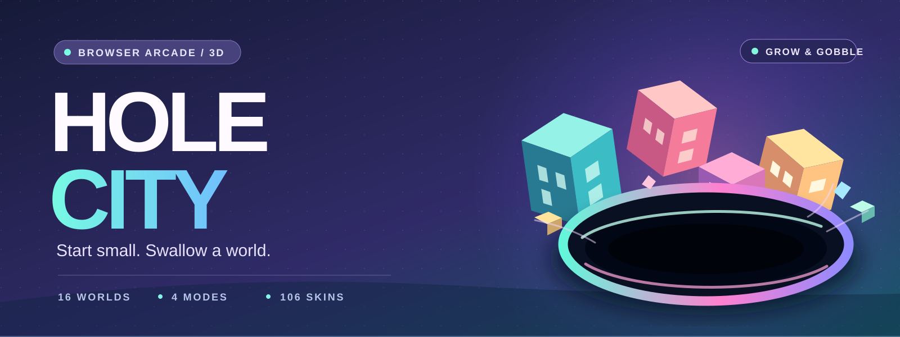
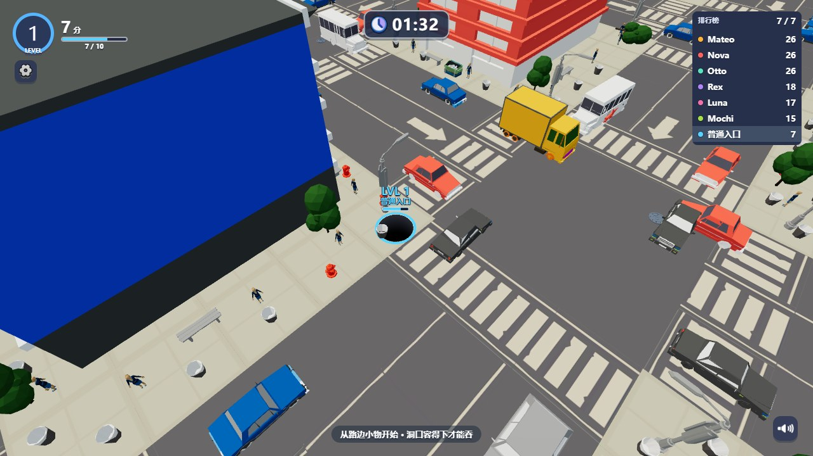
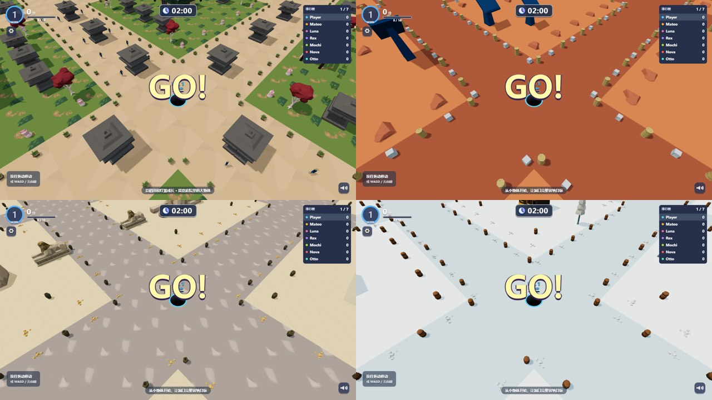

<h1 align="center">🌀 HOLE CITY</h1>

<p align="center">
  <a href="https://seiya058904.github.io/Hole-City/"></a>
  <br>
  <sub>ORIGINAL VECTOR COVER ART · REAL IN-GAME SCREENSHOTS BELOW</sub>
</p>

<p align="center">
  <strong>Start small. Swallow a world.</strong>
</p>

<p align="center">
  A colorful 3D browser game about growing from a tiny hole into a city-sized force.<br>
  Hunt for what fits, outgrow your rivals, and watch the world fall away beneath you.
</p>

<p align="center">
  <a href="https://seiya058904.github.io/Hole-City/"><strong>▶ Play in Your Browser</strong></a>
  &nbsp;·&nbsp;
  <a href="https://github.com/seiya058904/Hole-City/releases/latest">⬇ Download v1.0.1</a>
  &nbsp;·&nbsp;
  <a href="#choose-your-mode">🎮 Game Modes</a>
  &nbsp;·&nbsp;
  <a href="#explore-the-worlds">🌍 Explore Worlds</a>
  &nbsp;·&nbsp;
  <a href="#how-you-grow">🌱 Progression</a>
  &nbsp;·&nbsp;
  <a href="#play-and-controls">⌨️ Controls</a>
</p>

<p align="center">
  <sub>16 PLAYABLE WORLDS &nbsp;·&nbsp; 4 GAME MODES &nbsp;·&nbsp; 106 COSMETIC SKINS &nbsp;·&nbsp; LOCAL PROGRESS</sub>
</p>

<p align="center">
  
  <br>
  <sub>ACTUAL BROWSER GAMEPLAY · CHINESE-LANGUAGE INTERFACE</sub>
</p>

---

> **A bigger hole changes everything.**
>
> Start with street furniture and tiny objects. As your hole grows, vehicles and eventually whole buildings become possible targets. Every swallowed object opens up a new route through the map.

<a id="choose-your-mode"></a>
## 🎮 Four Ways to Play

<table>
  <tr>
    <td width="50%" valign="top">
      <h3>⏱️ Classic — The Two-Minute Race</h3>
      <p><sub>120 SECONDS · YOU + 6 AI RIVALS</sub></p>
      <p>Compete for the top of the leaderboard. Find an efficient eating route, grow faster than the other holes, and take the lead before time runs out. A dominant run can end early.</p>
    </td>
    <td width="50%" valign="top">
      <h3>🧹 Speedrun — Clear the Map</h3>
      <p><sub>600 SECONDS · SOLO CHALLENGE</sub></p>
      <p>No rivals to chase. Consume the map as thoroughly as you can before the timer expires. Completion is measured by the value of the objects removed.</p>
    </td>
  </tr>
  <tr>
    <td width="50%" valign="top">
      <h3>🏆 Battle Royale — Last Hole Standing</h3>
      <p><sub>20 HOLES · ELIMINATION</sub></p>
      <p>Size becomes survival. Swallow smaller opponents, avoid larger threats, and stay in the game until only one contender remains.</p>
    </td>
    <td width="50%" valign="top">
      <h3>♾️ Endless — Keep Growing</h3>
      <p><sub>STAGES · UPGRADES · LOCAL PROGRESSION</sub></p>
      <p>Move through successive growth stages, collect rewards, and improve your hole. Each world tracks its own progress, with bounded offline earnings.</p>
    </td>
  </tr>
</table>

<a id="explore-the-worlds"></a>
## 🌍 Sixteen Worlds, One Hungry Hole

From everyday streets to impossible landscapes, each setting changes what you see and what you can swallow.

<p align="center">
  
  <br>
  <sub>FOUR OF THE AVAILABLE ENVIRONMENTS · IN-GAME CAPTURES</sub>
</p>

<details>
<summary><strong>🗺️ Explore the complete world lineup</strong></summary>

| | | |
| --- | --- | --- |
| Modern City | Japanese Garden | Pirate Harbor |
| Rural Village | Western Town | Office Campus |
| Shopping Mall | Sci-Fi City | Mars Base |
| Military Camp | Ancient Ruins | Wasteland |
| Egyptian Ruins | Construction Site | Jurassic World |
| Winter Village | | |

</details>

### 📐 It's not just about your level

The hole's opening, an object's shape, and where that object is supported all matter. A car may tip and fall before a large building becomes swallowable; a bigger opening lets you go after targets that were previously out of reach. Skins change how your hole looks, not its core gameplay properties.

<a id="how-you-grow"></a>
## 🍬 Small Beginnings, Bigger Possibilities

Growth changes what the world offers. Targets that did not fit a moment ago can become your next opportunity.

| Stage | What to look for | What changes |
| --- | --- | --- |
| **Start small** | Street furniture and the smallest objects | Build size and open up new routes. |
| **Pick up momentum** | Larger props and vehicles | The environment becomes more valuable, and rival holes matter more. |
| **Change the skyline** | Structures and entire sections of the city | Your available targets and movement choices expand. |

This describes the **progression concept**, not an exact order of swallowable objects. Geometry, opening size and support conditions determine what fits in each encounter.

<p align="center"><code>FIND YOUR FIRST TARGET &nbsp;→&nbsp; GROW &nbsp;→&nbsp; CHANGE YOUR ROUTE &nbsp;→&nbsp; AIM BIGGER</code></p>

<a id="play-and-controls"></a>
## 🕹️ Play & Controls

<p align="center"><code>FIND SMALL OBJECTS &nbsp;→&nbsp; GROW &nbsp;→&nbsp; SWALLOW BIGGER TARGETS &nbsp;→&nbsp; REPEAT</code></p>

1. **Pick a world and mode.** Start a quick contest, clear a map, survive an elimination match, or continue an Endless run.
2. **Move through the environment.** Aim for targets your current hole can accommodate; the opening and objects' shapes affect what falls in.
3. **Grow into new opportunities.** Work up from roadside objects to vehicles and structures, or look for smaller rival holes in competitive modes.
4. **Finish or keep building.** Chase the leaderboard, clear the remaining objects, survive the field, or progress through Endless stages.

| Input | Action |
| --- | --- |
| **Mouse / touch** | Press and drag to move; release to stop |
| **Keyboard** | WASD or arrow keys to move |
| **Esc** | Pause |
| **Settings** | Adjust sound, switch between High Quality and Performance, and reduce motion |

> [!NOTE]
> The **in-game interface is in Simplified Chinese**; this README is in English. Use a modern **WebGL 2-capable browser**. Audio starts after your first interaction, and performance on phones depends on the device and selected quality setting.

## 💡 Tips for Your First Run

- **Start with clusters of small objects.** Early growth is the key to accessing larger targets.
- **Watch the shape, not just the size.** Supported or awkwardly positioned objects may need a different approach.
- **Match your strategy to your mode.** Classic is a score race, Speedrun is a clearing challenge, Battle Royale prioritizes survival, and Endless favors long-term growth.
- **Adjust quality when needed.** The Performance setting can make the 3D worlds more manageable on weaker hardware.

<a id="get-started"></a>
## 🚀 Play Online or Host It Yourself

### 🌐 Play online

**[Launch Hole City →](https://seiya058904.github.io/Hole-City/)**

No account or installation is needed for the hosted browser edition. The game does not connect to the original advertising, payment, or online leaderboard services.

### 📦 Download the browser distribution

Get the **[v1.0.1 browser ZIP from GitHub Releases](https://github.com/seiya058904/Hole-City/releases/tag/v1.0.1)**. The release also provides a SHA-256 checksum for the ZIP.

Extract the archive and serve the files from a local HTTP server or any static web host. For example, with Python 3 installed, open a terminal in the extracted directory:

```sh
python -m http.server 8000 --bind 127.0.0.1
```

Then open **http://localhost:8000/**. On Windows, `py -m http.server 8000 --bind 127.0.0.1` is an alternative if the Python launcher is installed.

Opening `index.html` directly using a `file://` URL is **not a supported deployment method**: browser restrictions can prevent the game's modules and assets from loading correctly. Preserve the directory structure when hosting.

### 💾 Your progress stays local

The game stores its progress and settings in the current browser's site storage. That means:

- A different browser, profile, or site address does **not** automatically share your progress.
- Clearing site data can remove your unlocks and saved Endless progression.
- If a save fails, a persistent warning offers **Retry Save** and **Export Current Progress**. Keep the page open until you have saved successfully or exported a recovery copy.
- Offline earnings in Endless mode are a **game progression feature**, not a promise that the entire site can be opened for the first time without a network connection.

<a id="inside-the-distribution"></a>
## ⚙️ Inside This Repository

This repository publishes the **built, playable web edition**, not the original development workspace.

| Path | What it contains |
| --- | --- |
| [`index.html`](index.html) | Browser entry point |
| [`assets/`](assets/) | Bundled game code, styles, models, textures, and audio |
| [`assets/manifest.json`](assets/manifest.json) | Runtime asset references |
| [`config/balance.json`](config/balance.json) | Shipped gameplay configuration |
| [`version.json`](version.json) | Build version and runtime file hashes |
| [`checksums.sha256`](checksums.sha256) | Distribution file checksums |
| [`media/`](media/) | Actual gameplay and world screenshots |
| [`THIRD_PARTY_NOTICES.md`](THIRD_PARTY_NOTICES.md) | Third-party notices and rights information |

<details>
<summary><strong>🔧 What is not included?</strong></summary>

The original TypeScript/C# development sources, raw asset workspace, automated tests, and internal development reports are **not included in this distribution**. The JavaScript shipped here is bundled and minified. That is a packaging choice, not encryption or a guarantee against extraction.

There is no repository-level source build command or test suite to run from this checkout. To develop or audit the game's underlying source, the original development project would be required.

</details>

## ❓ Frequently Asked Questions

<details>
<summary><strong>Is Hole City multiplayer?</strong></summary>

This browser edition is **single-player**. Competitive modes use AI-controlled opponents; no online matchmaking or account server is included.

</details>

<details>
<summary><strong>Can I play it on Android or a tablet?</strong></summary>

The controls include touch, and the game targets WebGL 2-capable browsers. Performance varies with the device, browser and quality setting. Compatibility across every phone has not been certified.

</details>

<details>
<summary><strong>Will Endless progress move between browsers?</strong></summary>

No. There is no cloud sync. Progress is stored locally by the browser and origin; clearing site data can delete it.

</details>

<details>
<summary><strong>Can I rebuild the game from this repository?</strong></summary>

You can serve the **compiled browser distribution**, but this repository does not include the original development source, asset authoring workspace or automated build and test suite.

</details>

## 📜 Credits & Rights

Hole City is a browser game project with third-party runtime components and game assets. The included Three.js notice is preserved in **[Third-party Notices](THIRD_PARTY_NOTICES.md)**.

This public repository does **not** declare a blanket open-source license for the game, its artwork, models, audio, or other third-party materials. Availability for download does not automatically grant reuse or redistribution rights.

---

<p align="center">
  <sub>START SMALL. THINK BIGGER. SWALLOW THE WORLD.</sub><br>
  <sub>Hole City · Four ways to play, sixteen worlds to explore.</sub>
</p>
