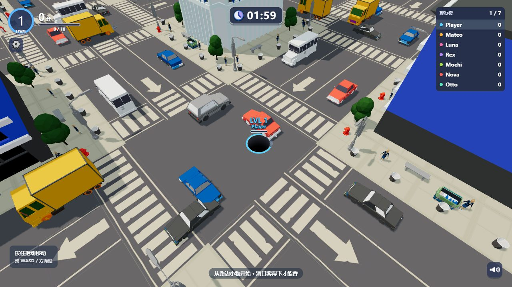

A single-player 3D browser game about moving a hole through the city, swallowing objects that fit, and growing into larger targets. The game interface is in Simplified Chinese.

[Play online](https://seiya058904.github.io/Hole-City/) · [Download the browser edition](https://github.com/seiya058904/Hole-City/releases/tag/v1.0.0) · [Controls](#controls)

*Illustration based on the game mechanics, not a screenshot.*

## Contents

- [Choose a mode](#choose-a-mode)
- [How to play](#how-to-play)
- [Controls](#controls)
- [Run the distribution locally](#run-the-distribution-locally)
- [Progress and settings](#progress-and-settings)
- [Inside this repository](#inside-this-repository)
- [Credits and rights](#credits-and-rights)

## Choose a mode

- **Classic:** compete for the highest score in a two-minute match against six AI holes; a dominant run can finish early.
- **Speedrun:** play solo and clear as much of the map as possible within ten minutes. Completion uses the objects' original point values.
- **Battle Royale:** survive a field of 20 holes without respawns; larger holes can eliminate smaller ones.
- **Endless:** advance through stages, collect rewards, and improve your hole with progress tracked per map and bounded offline earnings.



*Actual browser capture of the distribution served locally.*

## How to play

Choose a world and mode, then move toward small objects to gain size. As the opening grows, try larger props, vehicles, and buildings. The hole's opening, an object's shape, and rim support affect whether it falls; entering the opening does not guarantee an immediate score. Adapt your route to the mode: race for points, clear the map, survive rivals, or build long-term progress.

The game includes 16 environments and 106 cosmetic skins. Skins change appearance rather than core gameplay properties. Competitive modes use AI opponents; there is no online matchmaking.


*Four actual in-game environments.*

## Controls

| Input | Action |
| --- | --- |
| Mouse or touch | Press and drag to move; release to stop |
| WASD or arrow keys | Move the hole |
| Esc | Pause or open settings |

A modern WebGL 2-capable browser is required. Audio starts after interaction. Touch is supported, but performance varies by device and quality setting; broad physical-device compatibility is not certified.

## Run the distribution locally

This repository contains the **built web edition**, not the original development source. [Download the v1.0.0 ZIP](https://github.com/seiya058904/Hole-City/releases/tag/v1.0.0), extract it, and serve the extracted directory with a static HTTP server. For example, with Python 3:

```sh
python -m http.server 8000
```

Open `http://localhost:8000/`. On Windows, `py -m http.server 8000` is an alternative when the Python launcher is installed. Keep the extracted directory structure intact; opening `index.html` directly with `file://` is not supported. A SHA-256 checksum for the release ZIP is provided with the release.

## Progress and settings

Progress, unlocks, Endless stages, and settings are stored in the browser for the current site origin. A different browser, profile, or address does not share them automatically, and clearing site data can remove them. Endless offline earnings are a game mechanic, not a guarantee that the site can be opened for the first time without a connection.

Settings include audio, quality, and reduced motion. The hosted edition needs no account and does not use the original advertising, payment, or online leaderboard services.

## Inside this repository

| Path | Purpose |
| --- | --- |
| [`index.html`](index.html) | Browser entry point |
| [`assets/`](assets/) | Bundled game code, styles, models, textures, and audio |
| [`assets/manifest.json`](assets/manifest.json) | Runtime asset references |
| [`config/balance.json`](config/balance.json) | Shipped gameplay configuration |
| [`version.json`](version.json) and [`checksums.sha256`](checksums.sha256) | Distribution version and file hashes |
| [`media/`](media/) | README illustration and gameplay captures |

The TypeScript/C# development sources, raw asset workspace, automated tests, and internal development reports are not included. There is no source build or test command in this distribution; its JavaScript is bundled and minified, not encrypted.

## Credits and rights

The game includes third-party runtime components and assets. See [Third-party notices](THIRD_PARTY_NOTICES.md) for the included Three.js license and asset rights. This repository does not declare a blanket open-source license for the game, artwork, models, audio, or other third-party materials; download availability does not itself grant reuse or redistribution rights.
